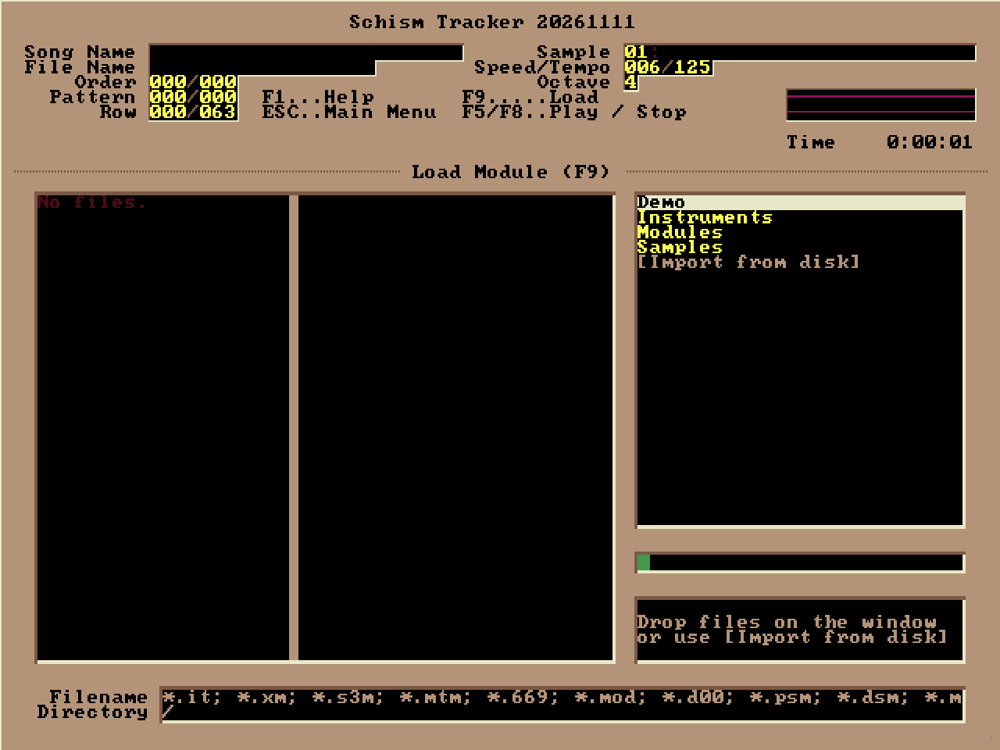
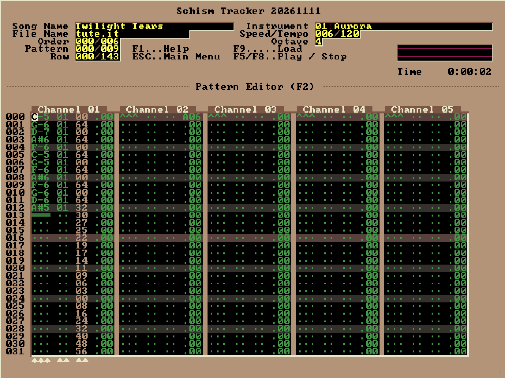

# schism-web

Schism Tracker (an Impulse Tracker clone) rewritten in plain JavaScript: ES
modules, a canvas and Web Audio. No WebAssembly and no build step.

    ./serve.sh                 # then open http://127.0.0.1:8600/schism/

Load modules by dropping them on the window or with F9 -> `[Import from disk]`.
IT, XM, S3M and MOD load; IT, S3M and MOD save (saved files also download).
See PROGRESS.md for what works and what doesn't, PORTING.md per C file.

    python3 test/parity.py     # pixel-compare against the original (needs ../schism-web/dist)
    python3 tools/gen-data.py  # regenerate js/gen/ from ../schismtracker

This is a derivative of Schism Tracker and carries its licence, GPL-2.0-or-later.
It is a separate project: Schism does not accept machine-generated code, so
nothing here should be sent upstream.
